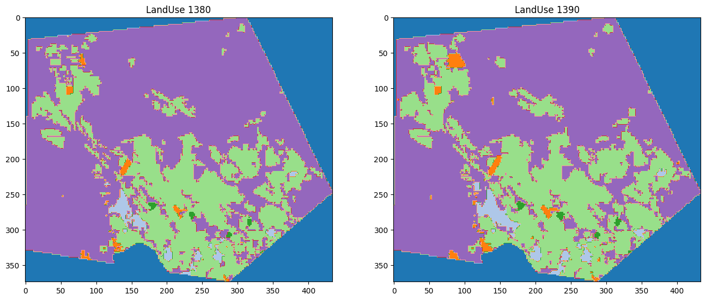
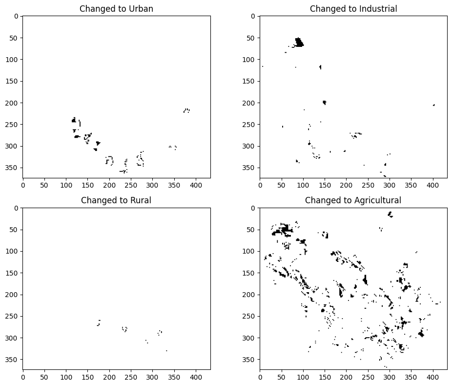
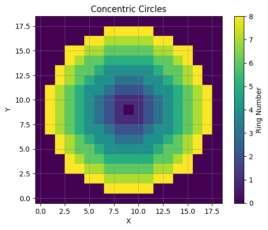
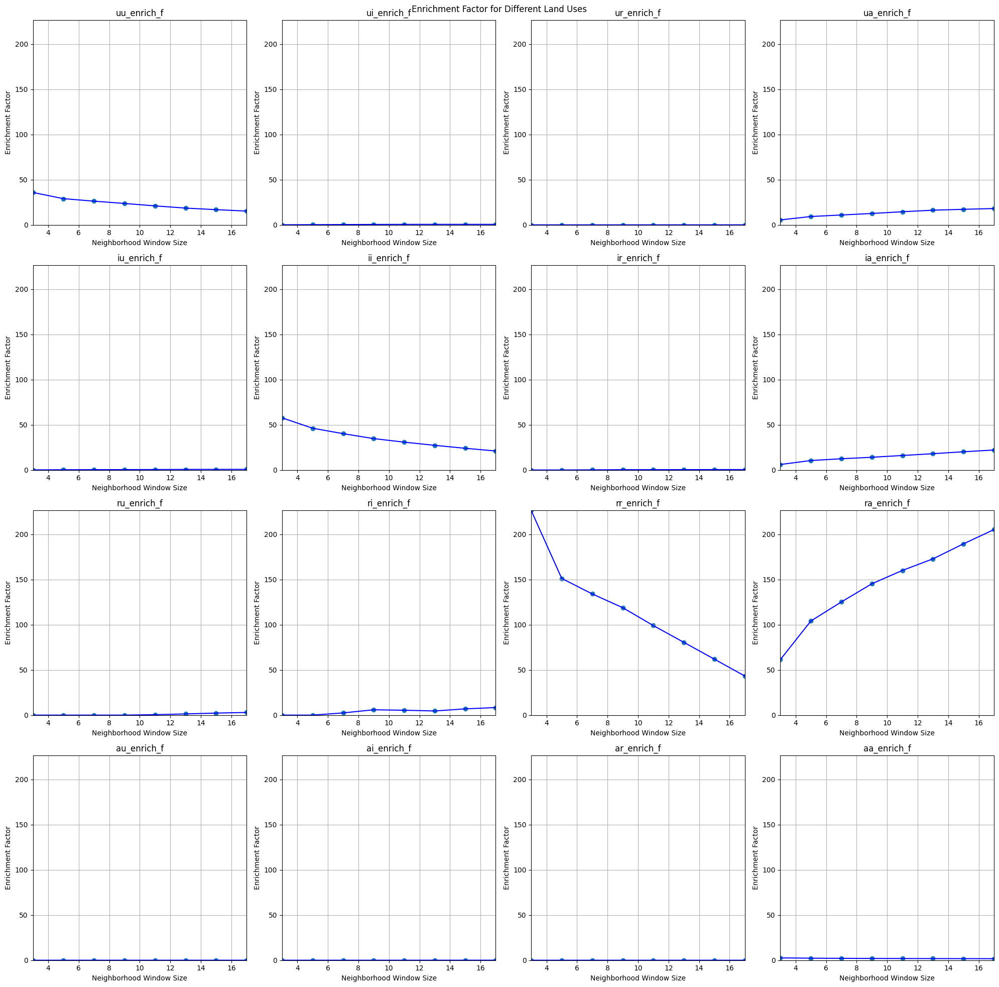
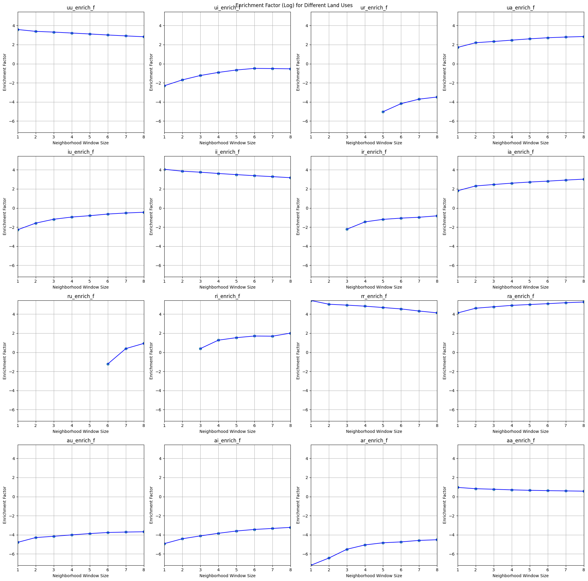
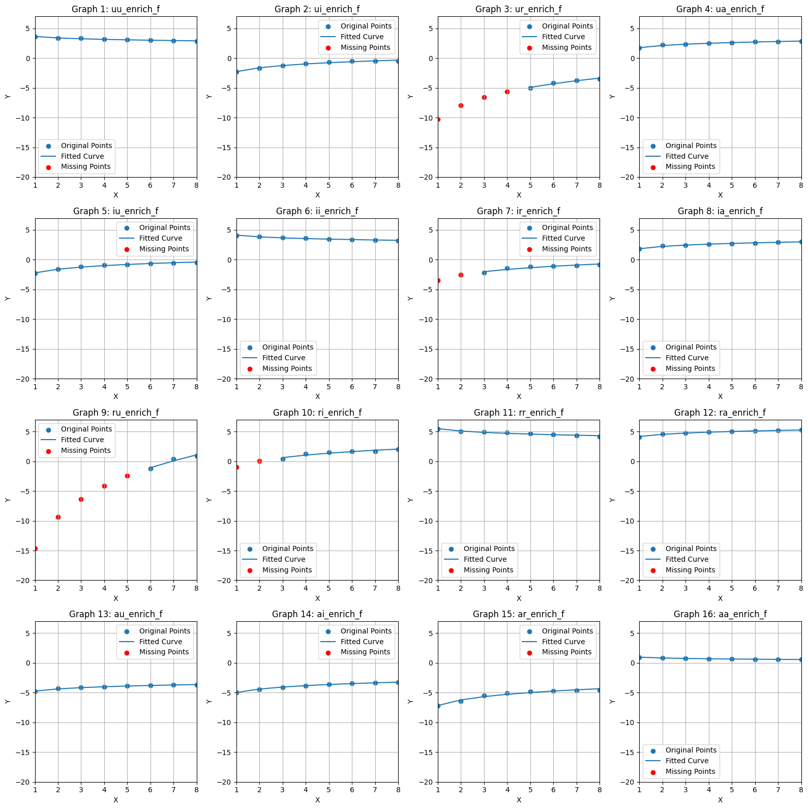
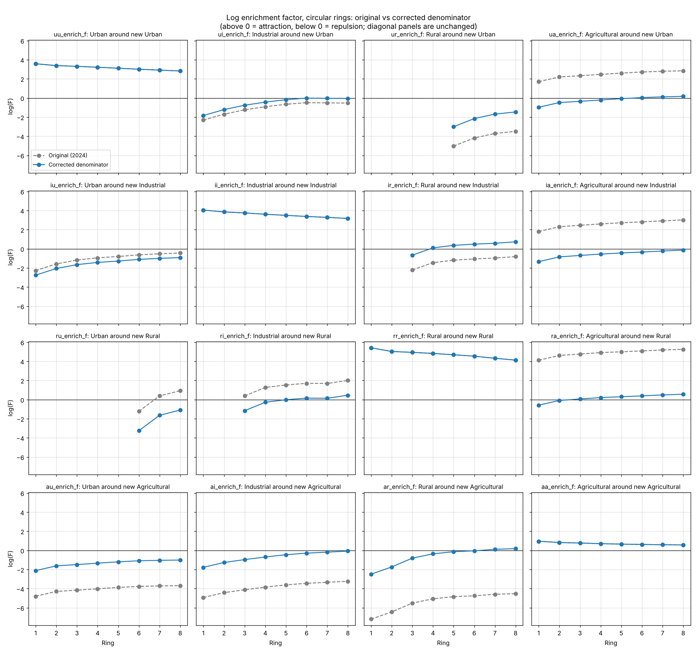

# Land-Use Neighbourhood Analysis with the Enrichment Factor

Measuring how land-use change is shaped by its surroundings. For every pixel that changed land use between two maps, this analysis asks which land uses were over- or under-represented around it, ring by ring, out to eight rings. The resulting attraction/repulsion curves are the empirical basis for the neighbourhood rules of cellular-automaton land-use models.

> Developed in **June 2024** for the *Spatial & Land Use Planning* course of my MSc in GIS (K. N. Toosi University of Technology).
> The notebook is published as originally written, with its explanations in Persian. This README describes it in English and adds a [2026 review](#review-2026) with one exact correction.

---

## The problem

Land-use change is not random in space. New urban areas appear next to existing ones, industry clusters, and farmland gives way at the urban fringe. To model this, for example with a cellular automaton (see my [urban growth CA project](https://github.com/KimyaKheirkhah/urban-growth-cellular-automata)), we need to know **how strongly each land use attracts or repels each other land use, and how that effect fades with distance**.

The **enrichment factor** (Verburg et al., 2004) quantifies this:

$$F_{k,d} = \frac{n_{k,d} / n_d}{N_k / N}$$

where $n_{k,d}/n_d$ is the share of land use *k* in the ring at distance *d* around a location, and $N_k/N$ is the share of *k* in the whole map.

- **F > 1** (log F > 0): *k* is over-represented nearby, i.e. **attraction**.
- **F < 1** (log F < 0): *k* is under-represented, i.e. **repulsion**.

## Data and approach

Two classified land-use maps of the same area, for **1380 and 1390** in the Iranian calendar (about 2001 and 2011), with urban, industrial, rural, agricultural and barren classes.



1. **Change detection.** For each target class (urban, industrial, rural, agricultural), find the pixels that changed *into* that class between the two dates.

   

2. **Neighbourhood rings.** Around every changed pixel, count each land use in 8 concentric rings. Two ring shapes were implemented and compared: **square rings** (3×3, 5×5, … 17×17 windows minus the inner window) and **circular rings** (pixels at distance *r ± 0.5*).

   

3. **Enrichment factors.** Compute F for every changed pixel and ring, then average per ring, for all **16 combinations** of changed-to class × neighbour class (urban–urban, urban–industrial, …, agricultural–agricultural).

   *Square rings:*
   

   *Circular rings, log scale:*
   

4. **Completing the curves.** Where a ring contains none of a land use, F = 0 and log F = −∞, so the curve starts only at a later ring. As specified in the course, these near rings were filled by fitting a logarithmic function (*a·ln(d) + b*) to the available rings and extrapolating it back to the first ring, so that every curve reaches the axis.

   

**What the same-class curves show** (urban–urban, industrial–industrial, rural–rural, agricultural–agricultural): new development is strongly attracted to existing land of the same type. The effect is strongest in the first ring and decays steadily with distance, which is the classic pattern behind neighbourhood rules in urban CA models. The strongest clustering is for rural (log F ≈ 5.4 in ring 1) and industrial land (≈ 4.1).

## Review (2026)

### The denominator: an exact correction

In the original code, the global share in the denominator was the share of the **changed-to** class, not of the **neighbour** class being counted. For example, for agricultural land around new urban pixels (`ua`), the agricultural share in the rings was divided by the *urban* share of the map (2.2%) instead of the *agricultural* share (32%).

This leaves the four same-class panels unchanged, but shifts the other 12, in both the square-ring and the circular-ring results. Because the wrong denominator is a single constant per panel, the correction is **exact** and needs no access to the original rasters:

$$\log F_{\text{correct}} = \log F_{\text{original}} + \ln\frac{N_{\text{changed-to}}}{N_{\text{neighbour}}}$$

[`corrected/correct_denominator.py`](corrected/correct_denominator.py) reads the per-ring values and the pixel counts saved in the original notebook and applies this correction. Only the circular-ring values were printed in full, so the corrected figure covers the circular rings:



The shape of every curve is unchanged, but several interpretations change:

| Pair | Original reading | Corrected reading |
|---|---|---|
| `ua`: agricultural around new urban | strong attraction (log F ≈ +1.7 → +2.8) | slight repulsion close by, **neutral** further out (−1.0 → +0.2) |
| `ia`: agricultural around new industrial | strong attraction | mild repulsion, approaching neutral |
| `ra`: agricultural around new rural | very strong attraction (≈ +4 → +5) | **close to neutral** (−0.6 → +0.6) |
| `ar`: rural around new agricultural | very strong repulsion (≈ −7 → −4.5) | repulsion close by, **neutral** from ring 5 |
| `ir`: rural around new industrial | repulsion | **attraction** from ring 4 onward |
| `ru`: urban around new rural | attraction at rings 7–8 | **repulsion** at all available rings |

### What I would do differently

- **Measure neighbourhoods on the earlier map.** Neighbour counts were taken from the 1390 map, *after* the change, so they include the converted pixels themselves and other conversions from the same period. The usual approach is the 1380 map: what surrounded a location *before* it changed. This inflates the same-class curves somewhat, and it can't be corrected without the original rasters.
- **Treat F = 0 as information.** A ring with none of a land use is evidence of strong repulsion, not missing data. Extrapolating a curve over it (step 4) produces a smooth, complete weight function for a CA model, but the extrapolated values should be labelled as modelled, not observed. With the data, I would also report how many changed pixels each ring is based on, since some averages rest on very few pixels.
- **Handle map edges.** Rings that extend past the map edge are only partially observed, but are divided by the full ring size. Dividing by the number of *valid* pixels in each ring removes this bias.
- **Vectorize.** The nested pixel loops can be replaced by a convolution per ring and per class, which gives identical counts in seconds.
- **Close the loop.** Use the corrected curves to set the neighbourhood weights of a CA model (as in constrained CA, White & Engelen, 1993) and validate the simulation of 1380 → 1390 against the observed 1390 map.

## Repository contents

```
original/land_use_enrichment_factor_2024.ipynb  # the full analysis, as written in 2024 (Persian explanations)
corrected/correct_denominator.py                 # exact denominator correction from the notebook's saved outputs
figures/                                         # figures used in this README
```

The land-use rasters are not included. To reproduce the corrected figure:

```bash
pip install -r requirements.txt
python corrected/correct_denominator.py
```

## References

- Verburg, P. H., de Nijs, T. C. M., Ritsema van Eck, J., Visser, H., & de Jong, K. (2004). A method to analyse neighbourhood characteristics of land use patterns. *Computers, Environment and Urban Systems*, 28(6), 667–690.
- White, R., & Engelen, G. (1993). Cellular automata and fractal urban form: a cellular modelling approach to the evolution of urban land-use patterns. *Environment and Planning A*, 25(8), 1175–1199.

## License

[MIT](LICENSE) © 2024–2026 Kimya Kheirkhah · [github.com/KimyaKheirkhah](https://github.com/KimyaKheirkhah)
